<p align="center">
  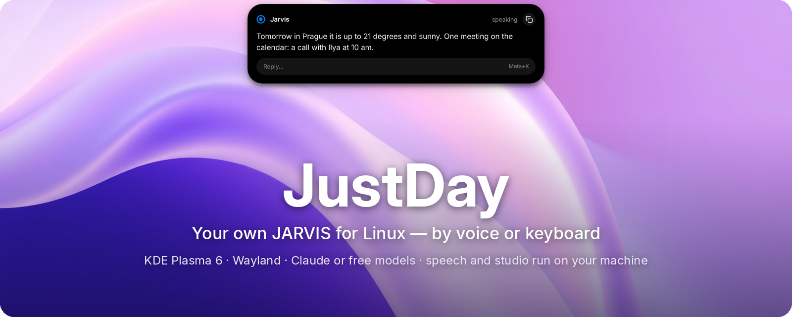
</p>

<p align="center"><a href="README.ru.md"><b>Читать на русском</b></a></p>

<p align="center">
  <a href="LICENSE"></a>
  
  
  
  <a href="https://github.com/0nigiris/JustDay/commits/main"></a>
  <a href="https://github.com/0nigiris/JustDay/actions/workflows/check.yml"></a>
</p>

<p align="center">
  <a href="#install">Install</a> ·
  <a href="#what-it-does">What it does</a> ·
  <a href="#how-it-looks">How it looks</a> ·
  <a href="#voice-or-keyboard">Keyboard</a> ·
  <a href="#music-and-video">Music & video</a> ·
  <a href="#studio">Studio</a> ·
  <a href="#models">Models</a> ·
  <a href="#privacy">Privacy</a> ·
  <a href="README.ru.md">Русский</a>
</p>

**JustDay** is an AI assistant for Linux that **acts**, not just answers: it opens apps and sites, presses buttons in windows, installs software, writes messages and mail, draws pictures, edits video, plays games and hands coding to Claude Code. Talk to it or type — the answer shows up in a **Dynamic Island** at the top of the screen.

JustDay is long past a voice helper. It is a desktop built around one island: dock, tray, menu, Spotlight, player, video, mail, an editing studio and tasks in separate chats. Every part has a fallback: when one model or key runs out, the next one carries on. Each part restarts on its own, and updates run in the background with no terminal and no vanishing dock.

**What's new (November)**
- **Dock right away.** The shell used to wait up to 12 seconds for the daemon after login. It now starts at once and connects to the daemon on the fly.
- **Own calendar.** `justday calendar add "Meeting" --start "2026-11-07 15:00"`: no accounts, keys or cloud consoles. The file lives on your computer; it is shown first and written after you confirm. Other calendars (any ICS link) are read alongside it.
- **Menu edit mode like on a phone.** Blocks wiggle, a red minus hides one, dragging reorders, Escape leaves.
- **Your own island widgets, accent colour, font and one slider for the size of everything.**
- **Plasma 5 and X11 without a GPU or microphone.** Works by text; a fallback bar replaces the island.
- **Night shift.** `justday terminal --night`: work goes on from the plan while you sleep; anything that needs a confirmation waits for morning.
- **Install without admin rights.** Everything goes to your home folder; `bash scripts/check-pc.sh` tells you before installing what will work on this computer.
- **Suitcase.** `justday suitcase export file` packs settings and keys into one file under your password; `import` unpacks it on another computer.
- **Several keys.** An ElevenLabs key and a spare (`ELEVENLABS_API_KEY_2`): when the first runs out, the voice takes the second.
- **Per-part restart.** `justday module list` and `justday module restart ID`; the island only redraws.
- **Tasks in separate chats.** A big job lives in its own chat for a week (configurable); a pinned chat is never archived.

## Install

```bash
curl -fsSL https://raw.githubusercontent.com/0nigiris/JustDay/main/install.sh | bash
```

The installer asks what to install, shows one line per step, installs what is missing (asking for your password once, after showing what it is for) and then runs a short setup: language, name, model (it helps you sign in to Claude or pick a free one), **voice or text only**, the voice, the keys, mail and weather. Everything can be changed later in the island's settings.

**Only what you need gets installed.** Speech recognition (550 MB), the neural voice (750 MB) and NVIDIA acceleration (2.2 GB) are a choice: with no microphone and no headphones the 250 MB core is enough and commands are typed. Without questions: `./install.sh --text-only`, `--no-gpu`, `--everything`, `--parts speech`. Add a part later with `justday parts add speech`, see what is there with `justday parts`. Long steps show how much has been downloaded so far, `--debug` prints everything the tools do, and Ctrl+C breaks nothing: the next run continues from the same place.

| You need | For |
|---|---|
| KDE Plasma 6 on Wayland, PipeWire | the island, hotkeys, window control (on X11 and Plasma 5 everything works except the island and clicks inside other windows) |
| A Claude subscription **or** a free model | the brain: Claude, Ollama's cloud, OpenRouter, DeepSeek, local Ollama |
| An NVIDIA GPU — *optional* | the neural voice, fast speech recognition, local models and the studio. Without one JustDay still works: by text, with a simple voice and a cloud model |

## What it does

You say what you want. It does the whole thing, not just the first step.

**Your computer**
- “Install OBS” installs OBS from the most trusted source (Fedora, Flathub, COPR). Your password goes only into the system dialog; the assistant never sees it.
- “Open Discord”, “close the browser”, “press Save”: it opens apps, switches windows and clicks buttons inside other programs. Buttons in Qt and GTK apps get numbered labels, so a click lands exactly.
- “I'm sitting down to work” opens your editor and messenger and starts the music. One phrase, your own scenario.
- “Update the system”, then “play some music”: the music starts right away. Long jobs run in the background and show on the island.
- Games from Steam, Heroic and other launchers start by the name you call them.

**Music and video**
- “Play Back in Black”: three to five seconds later it plays in the island's own player. The original, not a cover or an hour-long loop. Next time it plays from disk, even offline.
- “Pause”, “next”, “louder” work instantly, without a model.
- The island takes the colour of the cover. When the cover says nothing, it picks the colour from what the track is about.
- Videos play in the island over the screen, in a window or on YouTube.

**People, mail and your day**
- “Tell Ilya I'll be late”: the text shows on the island first and goes out only after your “yes”.
- A local model reads and writes your mail, so letters never go to the cloud.
- A calendar with no accounts and no cloud consoles; Google Calendar connects too.
- The first “hello” of the day brings the weather, your next meeting, new mail and what was left from yesterday.
- “Wake me up at 7:30 every day”, “a timer for 10 minutes”, “a meeting at 15:00 Moscow time”: set instantly, without a model.
- It notices you have been gaming for four hours or forgot a promise, and says so once a day.

**A studio on your GPU**
- Pictures, background removal, 4× upscaling, photo edits by words.
- Music and songs with vocals, 3D models from text or a photo, video from text, a photo brought to life.
- Voice-over, subtitles, and montage: trim, join, add music, make a vertical cut, remove pauses, build a GIF.

**Code**
- Hands coding tasks to background Claude Code sessions, checks the result and reports back.
- Its own terminal with a model router: when one model hits its limit, the next one carries on.
- A night shift: work goes on from the plan while you sleep; anything that needs a confirmation waits for morning.

**Voice and character**
- A live neural voice on your GPU: “Jarvis”, a voice from a description, or one cloned from a recording. ElevenLabs if you like.
- Numbers, times and dates are spoken as words; English words go to an engine that can say them.
- A butler, a friend, a calm helper, or a character you describe yourself.
- It remembers people (“Ilya is the one in Poland, message him on Discord”), habits and where your files live. The memory is shared by every model.

**From your phone**
- The same request and the same player from your phone or Telegram, through the [phone half](phone/README.md). A computer that is off can be woken from the phone.

A detailed list with “verified / with a caveat” marks is in [CAPABILITIES.md](CAPABILITIES.md) (in Russian).

## How it looks

<table>
<tr>
<td width="50%" align="center">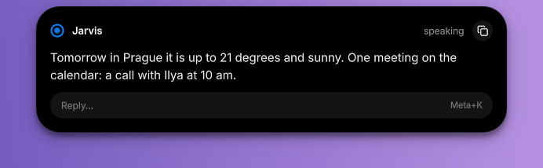<br><sub><b>An answer</b> — spoken and written; reply or copy right away</sub></td>
<td width="50%" align="center">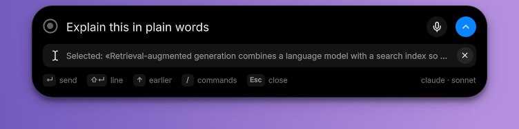<br><sub><b>Meta+K</b> — the text field, with the selected text already attached</sub></td>
</tr>
<tr>
<td align="center">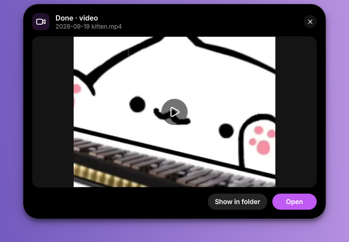<br><sub><b>Studio</b> — a finished video with a preview; long jobs run in the background</sub></td>
<td align="center">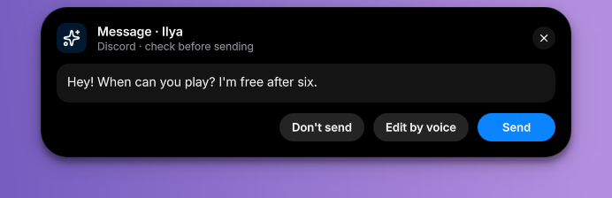<br><sub><b>A message</b> — nothing is sent without your “yes”</sub></td>
</tr>
<tr>
<td align="center">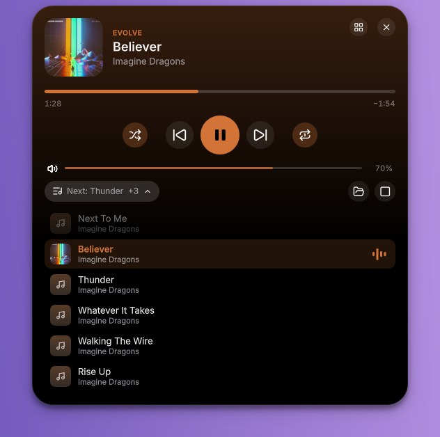<br>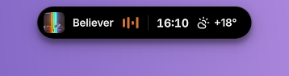<br><sub><b>Music</b> — albums and playlists, queue, shuffle and repeat; while it plays the island shows the cover and bars next to the time and weather</sub></td>
<td align="center">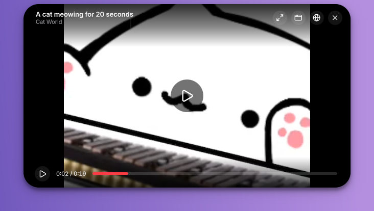<br><sub><b>Video right in the island</b> — or in a window, or on YouTube: Jarvis asks</sub></td>
</tr>
<tr>
<td align="center">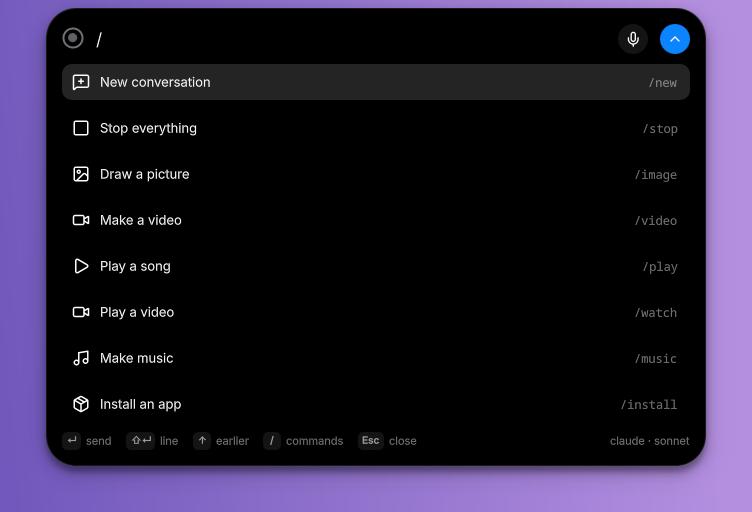<br><sub><b>/</b> — quick commands: new conversation, picture, video, microphone…</sub></td>
<td align="center">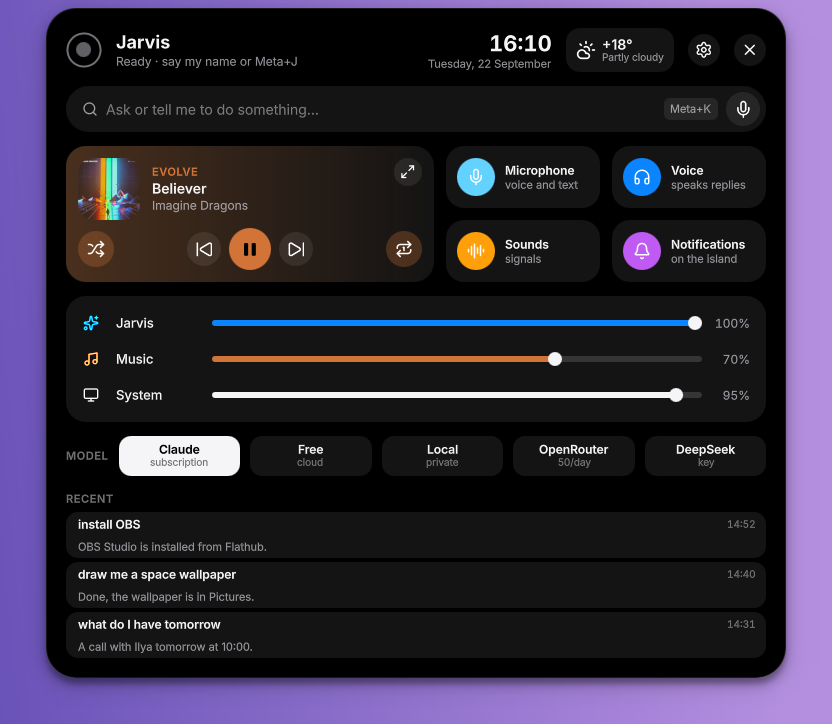<br><sub><b>The menu</b> — music, switches, three volumes (the assistant, the music, the system), the model, notifications and recent requests</sub></td>
</tr>
<tr>
<td align="center">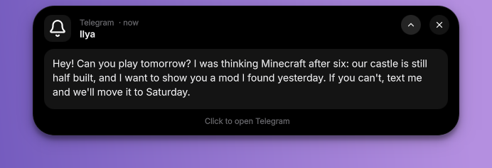<br><sub><b>Notifications</b> — ⌄ opens the whole message, dismisses it, a click opens the app — even from the tray</sub></td>
<td align="center"><br><sub><b>Video</b> — it asks where to play it</sub></td>
</tr>
<tr>
<td align="center"><br>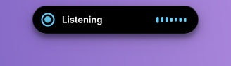<br><sub>What it is doing right now — in plain words</sub></td>
<td align="center">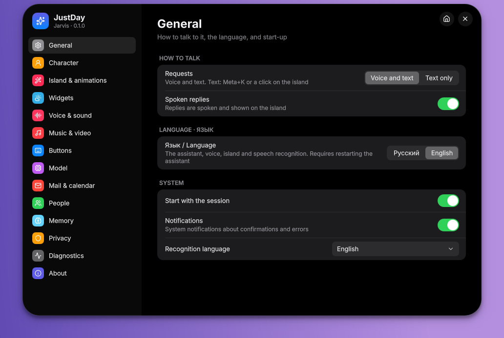<br><sub><b>Settings</b> right in the island: 14 sections</sub></td>
</tr>
<tr>
<td align="center">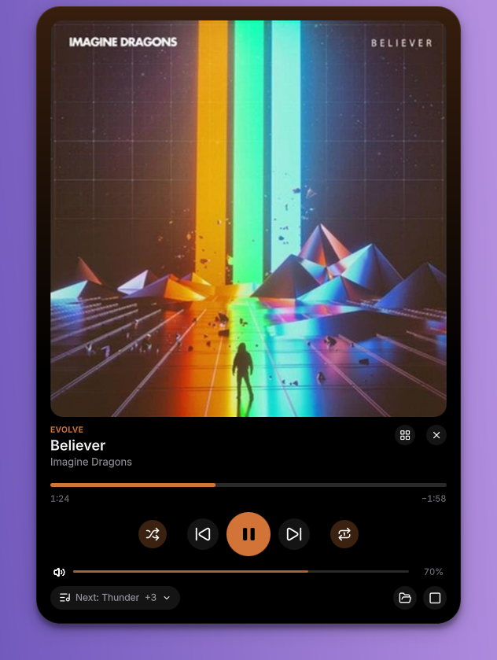<br><sub><b>The cover</b> — a click shows it large; the island's colour comes from the cover or from what the track is about</sub></td>
<td align="center">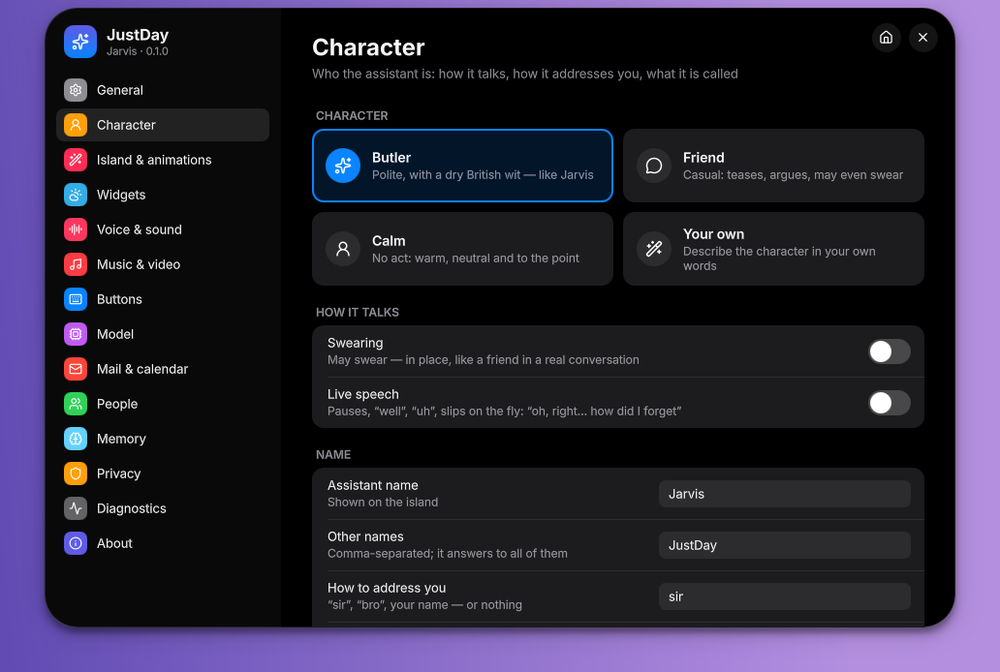<br><sub><b>Character</b> — butler, friend, calm or your own; swearing and live speech separately</sub></td>
</tr>
</table>

## Voice or keyboard

| Keys | What they do |
|---|---|
| <kbd>Meta</kbd>+<kbd>J</kbd> (or a mouse button) | talk: press — it listens until you pause; hold — while you hold. In text-only mode — the text field |
| <kbd>Meta</kbd>+<kbd>K</kbd> | type a request; the text selected on screen is attached |
| <kbd>Meta</kbd>+<kbd>Y</kbd> / <kbd>Meta</kbd>+<kbd>N</kbd> | “yes” / “no” to the island's question: allow an action, send a message |
| <kbd>Meta</kbd>+<kbd>Shift</kbd>+<kbd>J</kbd>, a double press, or “stop” | cancel everything |
| In the text field: <kbd>Enter</kbd> · <kbd>Shift</kbd>+<kbd>Enter</kbd> · <kbd>↑</kbd> · <kbd>/</kbd> · <kbd>Esc</kbd> | send · new line · earlier requests · commands · close |

**Without a microphone** (school, office, library): *Settings → General → Requests → “Text only”*. The microphone is never opened, speech recognition is not even loaded, and replies can be text only too (*“Spoken replies”*). All keys can be changed in *Settings → Buttons*.

## Music and video

“Jarvis, play Back in Black” — it plays in 3–5 seconds, without chatter. JustDay finds the song on YouTube (the original, not a cover or an hour-long loop), downloads the audio to `~/Music/JustDay/YouTube` and plays it in its own player. Next time the song plays from disk, even offline. Whole albums and playlists work (“play the album Meteora”), artists (“play Linkin Park”), shuffled or on repeat.

- While music plays, a **live pill** sits at the top: the cover, the title and the bars, and next to them the time, the weather and whatever runs in the background. A click opens the player with seeking, volume and the queue; a click on the cover shows it large.
- **The island's colour** is the cover's — and when the cover says nothing (black, grey), the model picks, once, the colour of what the track is about: a character's theme, a game's palette.
- “pause”, “next”, “back”, “shuffle”, “repeat”, “stop the music” work instantly, without AI. The player has the same buttons and the queue: a click on a song plays it. While Jarvis listens or speaks, the music gets quieter.
- The player is a separate service, so the music keeps playing even when the assistant restarts.

“Play a video about black holes” — Jarvis finds one and **asks where to show it**:

- **In the island** — the video loads (up to 720p) and plays right at the top of the screen, with the assistant's words as captions; a double click opens it full screen.
- **In a window** — a separate mpv player, starts at once.
- **YouTube** — the page in your browser, with comments.

To stop being asked, pick one in *Settings → Music & video*.

## Studio

Say or type: “draw a logo with a transparent background”, “bring this photo to life”, “make a 30-second lo-fi beat”, “turn this photo of a chair into a 3D model”, “cut the pauses out of this video and make it vertical for shorts”.

| What | How long on an RTX 3060 |
|---|---|
| A picture, a picture without background, ×4 upscale | 10–40 s |
| A photo edit from words | 1–2 min |
| Music and songs (with vocals) | ~15 s per 10 s of track |
| A 3D model from text or a photo → GLB + STL | ~3 min, in the background |
| Video from text or a photo | ~8 min per 3 s, in the background — JustDay tells you when it's ready |
| Voice-over in the assistant's voice, subtitles from speech | seconds |
| Montage: trim, join, music under video, burned-in subtitles, vertical 9:16, pause removal, speed-up, GIF, slideshow | seconds, ffmpeg |

Generation runs through a local [ComfyUI](https://github.com/comfyanonymous/ComfyUI) with FLUX.1-schnell, Qwen-Image-Edit, Wan 2.2, ACE-Step and Hunyuan3D. JustDay finds it by itself (`~/ai-local/ComfyUI`, `~/ComfyUI` or `[studio] comfy_dir`), runs it only on `127.0.0.1` and in a separate service with a memory limit. Check: `justday studio status`. Montage, subtitles and voice-over work without a GPU too.

## Models

| Provider | Price | What you need |
|---|---|---|
| **Claude** (default) | a Claude subscription | signed in to Claude Code — the setup helps |
| **Free** — Ollama's cloud | free, with limits | a free Ollama account |
| **OpenRouter** `openrouter/free` | free, ~50 requests a day | an OpenRouter key |
| **DeepSeek** | cheap | a DeepSeek key |
| **Local** Ollama | free, nothing leaves the machine | a GPU with 10 GB or more |
| Your own endpoint | — | any Anthropic-compatible API (LiteLLM, vLLM…) |

Memory, skills and the address book are shared by all models. Switch: island → menu → “Model”, or `justday model use <provider> <model>`.

## Privacy

| Stays on your computer | Goes to the cloud |
|---|---|
| microphone audio and speech recognition, the assistant's voice | the text of your requests and the replies — to the chosen model |
| mail, calendar, instant commands | selected text — only when it is attached to a request (you see it in the field) |
| pictures, video, music and 3D from the studio | the city name for the weather (Open-Meteo) |
| passwords and keys — in the system keyring, never in the assistant's memory | track titles, once each, when the island picks a colour from the music (can be turned off) |

Claude Code telemetry is off. Dangerous actions (deleting, `sudo`, force-push…) wait for your confirmation — also when they are started as background jobs; launching an app does not. More in the [manual](docs/MANUAL.md) (in Russian).

## Commands

```bash
justday ask "open discord"               # a request from the terminal
justday compose                          # open the text field on the island
justday play "AC/DC Back in Black"  # a song from YouTube in its own player (count=5 — several)
justday video "black holes" where=island # video: island | window | browser (no where — it asks)
justday play "Linkin Park Meteora" playlist=1 shuffle=1   # an album, shuffled
justday player repeat one                # pause | next | prev | repeat off|all|one | shuffle on|off | seek 60 | volume 50 | color yellow
justday job start "System update" -- jii update --json   # something long, in the background
justday persona friend swearing=on live=on               # the character: jarvis | friend | calm | custom
justday studio image "a red fox, watercolor" size=wide
justday studio vertical ~/Videos/clip.mp4
justday setup                            # the setup again
justday doctor                           # check everything
justday update                           # update (the island tells you when there is something new)
justday logs -f                          # what it hears and does
```

<details>
<summary><b>Questions</b></summary>

**Does it work without an NVIDIA GPU?** Yes. The setup picks speech recognition on the CPU (or text-only mode), the simple Silero voice and a cloud model. Only the neural voice, local models and studio generation are not available.

**Can I use it without voice at all?** Yes: *Settings → General → “Text only”* and turn off *“Spoken replies”*. <kbd>Meta</kbd>+<kbd>K</kbd> opens the text field.

**Will it send or delete something on its own?** Messages and mail only after your “yes”. Deleting files, `sudo`, removing software and other dangerous actions need a confirmation too.

**Other desktops (GNOME, X11, Plasma 5)?** It works — the island is replaced by a fallback strip at the top of the screen (written in Tk): state, answers, and a right-click menu with “Type…”, “Stop” and the player buttons. Windows are handled by `wmctrl` and `xdotool`, screenshots by whichever tool is installed, the selected text through `xclip`, and GNOME shortcuts by `scripts/setup-hotkey-gnome.sh`. The installer works all of this out by itself — and not once and for all: on a computer that offers both Wayland and X11, the right one is picked at every login, with nothing to reinstall when you switch. KDE Plasma 6 on Wayland keeps the island itself (player, video in frame, mail cards) and the exact clicks inside other windows.

**No admin rights (`sudo`)?** The install runs to the end: everything but the system packages lives in your home folder. The installer sets up `uv`, Claude Code, the Python environment and the models, and picks up `yt-dlp` for music through `uv tool`. At the end it lists what is missing, what stops working because of it, and the exact command for an admin. You can also skip the question entirely: `JUSTDAY_NO_SUDO=1 ./install.sh`.

**Where do studio files go?** `~/Pictures/JustDay`, `~/Videos/JustDay`, `~/Music/JustDay` and `~/Documents/JustDay/3D`; the island has “Open” and “Show in folder” buttons.

**Does it speak English?** Yes — the island, the settings, the voice and the replies. *Settings → General → Language*.

</details>

**[The full manual](docs/MANUAL.md)** (in Russian) — how it works, models, voice, memory, mail, games, studio, safety, troubleshooting.

## Contributing

Bugs and ideas — in [Issues](https://github.com/0nigiris/JustDay/issues). Code, comments and commit history are in English; the interface is in Russian and English (`island/i18n`, `src/justday/i18n.py`). The README screenshots are taken in an isolated KWin session with default settings, in both languages: `SHOTS_LANG=ru|en tests/ui/readme_shots.sh`.

## License

JustDay © 2026 [0nigiris](https://github.com/0nigiris) — **GNU GPL v3 or later** ([LICENSE](LICENSE)): you may change and share the code, keeping the authorship and keeping derived versions open under the GPL.

Third-party parts: [Lucide](https://lucide.dev) icons (ISC); the built-in voices were made with Qwen3-TTS (Apache 2.0); the interface is inspired by the Dynamic Island, the ChatGPT companion window and Raycast's Quick AI.
