<p align="center">
  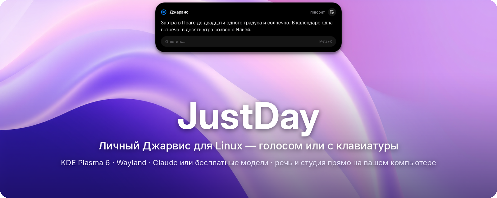
</p>

<p align="center">
  <a href="LICENSE"></a>
  
  
  
  <a href="https://github.com/0nigiris/JustDay/commits/main"></a>
  <a href="https://github.com/0nigiris/JustDay/actions/workflows/check.yml"></a>
</p>

<p align="center">
  <a href="#установка">Установка</a> ·
  <a href="#что-умеет">Что умеет</a> ·
  <a href="#как-выглядит">Как выглядит</a> ·
  <a href="#голосом-или-с-клавиатуры">Клавиатура</a> ·
  <a href="#музыка-и-видео">Музыка и видео</a> ·
  <a href="#студия">Студия</a> ·
  <a href="#модели">Модели</a> ·
  <a href="#приватность">Приватность</a> ·
  <a href="docs/MANUAL.md">Руководство</a> ·
  <a href="README.en.md">English</a>
</p>

<h3 align="center">Ассистент для Linux, который не просто отвечает, а делает.</h3>

<p align="center">
Говорите или пишите — ответ появляется в островке сверху экрана.<br>
Он открывает программы, нажимает кнопки в окнах, ставит софт, пишет письма, рисует, монтирует видео<br>
и раздаёт задачи Claude Code.
</p>

<table>
<tr>
<td align="center" width="25%"><b>🏝️ Остров, док, лоток</b><br><sub>весь рабочий стол вокруг одного острова</sub></td>
<td align="center" width="25%"><b>🔁 Роутер моделей</b><br><sub>кончился лимит — работу берёт следующая</sub></td>
<td align="center" width="25%"><b>🔒 Речь — локально</b><br><sub>микрофон и письма не уходят в облако</sub></td>
<td align="center" width="25%"><b>⚡ Без прав администратора</b><br><sub>всё ставится в домашнюю папку</sub></td>
</tr>
</table>

<details open>
<summary><b>✨ Что нового (ноябрь)</b></summary>

- **Док сразу.** Раньше после входа в систему док ждал, пока проснётся демон, до 12 секунд. Теперь оболочка стартует немедленно и подключается к демону на ходу.
- **Свой календарь.** `justday calendar add "Встреча" --start "2026-11-07 15:00"`: без аккаунтов, ключей и настройки в облачных консолях. Файл лежит на компьютере, показ перед записью, запись после подтверждения.
- **Правка главного меню как на телефоне.** Блоки дрожат, красный минус прячет, перетаскивание меняет порядок, Escape выходит.
- **Свои виджеты острова, цвет акцента, шрифт и размер всего интерфейса** одним ползунком.
- **Присмотр.** Джарвис сам замечает, что вы засиделись в игре или забыли про обещанное, и говорит раз в день, без пустых напоминаний.
- **Plasma 5 и X11 без видеокарты и микрофона.** Работает текстом, остров заменяет запасная полоска.
- **Ночная смена.** `justday terminal --night`: пока вы спите, работа идёт по плану, а всё, что требует подтверждения, ждёт утра.
- **Установка без прав администратора.** Всё ложится в домашнюю папку; `bash scripts/check-pc.sh` до установки скажет, что заработает на этом компьютере.
- **Чемодан.** `justday suitcase export файл` собирает настройки и ключи в один файл под вашим паролем, `import` раскладывает их на другом компьютере.
- **Перезапуск по частям.** `justday module list` и `justday module restart ID`; остров только перерисовывается.

</details>

## Установка

```bash
curl -fsSL https://raw.githubusercontent.com/0nigiris/JustDay/main/install.sh | bash
```

Установщик спросит, что ставить, поставит зависимости и запустит мастер настройки: язык, имя, модель (поможет войти в Claude или выбрать бесплатную), **голосом или только текстом**, голос, кнопки, почта и погода. Всё потом меняется в настройках острова.

**Ставится только то, что нужно.** Распознавание речи (550 МБ), нейросетевой голос (750 МБ) и ускорение на видеокарте NVIDIA (2,2 ГБ) — по выбору: без микрофона и наушников хватает ядра на 250 МБ, и команды пишутся с клавиатуры. Без вопросов: `./install.sh --text-only`, `--no-gpu`, `--everything`, `--parts speech`. Доставить потом — `justday parts add speech`; что стоит сейчас — `justday parts`. Долгие шаги показывают, сколько уже скачано, `--debug` печатает всё, что делают инструменты, а Ctrl+C ничего не портит: следующий запуск продолжит с того же места.

| Нужно | Зачем |
|---|---|
| KDE Plasma 6 на Wayland, PipeWire | остров, горячие клавиши, управление окнами (на X11 и Plasma 5 работает всё, кроме острова и кликов в чужих окнах) |
| Подписка Claude **или** бесплатная модель | «мозг»: Claude, облако Ollama, OpenRouter, DeepSeek, локальная Ollama |
| Видеокарта NVIDIA — *по желанию* | живой голос, быстрое распознавание, локальные модели и студия. Без неё JustDay работает: текстом, простым голосом и с облачной моделью |

## Что видно на экране

<table>
<tr>
<td width="58%" align="center">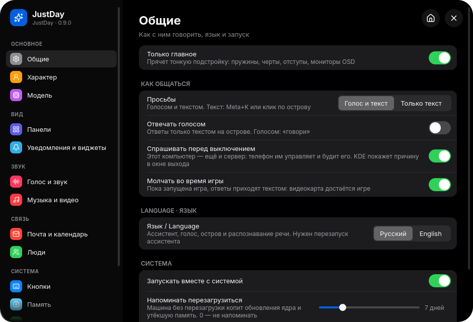<br><sub><b>Настройки</b> прямо в острове: язык, голос, вид, почта и календарь, кнопки</sub></td>
<td width="42%" align="center">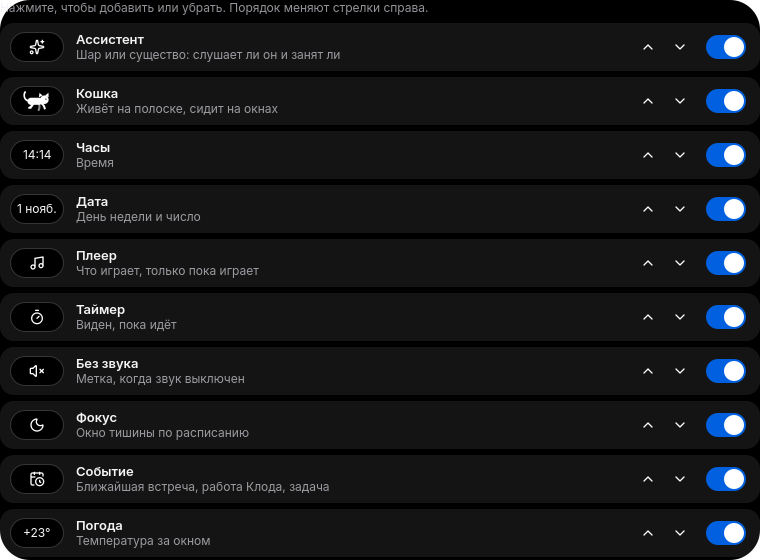<br><sub><b>Правка меню</b>: порядок стрелками, показать или скрыть каждый блок</sub></td>
</tr>
<tr>
<td align="center">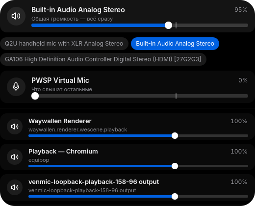<br><sub><b>Микшер</b> — громкость каждой программы и выбор устройства</sub></td>
<td align="center">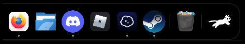<br><br><br><sub><b>Док</b> появляется сразу при входе, <b>полка</b>: эмодзи, буфер, звук, планы, история</sub></td>
</tr>
</table>

## Что умеет

<table>
<tr>
<td width="33%" valign="top">

**🖥️ Управляет компьютером**<br>
<sub>Приложения, окна, мышь и клавиатура.</sub>

</td>
<td width="33%" valign="top">

**⌨️ Голосом или текстом**<br>
<sub><kbd>Meta</kbd>+<kbd>J</kbd> — говорить, <kbd>Meta</kbd>+<kbd>K</kbd> — написать.</sub>

</td>
<td width="33%" valign="top">

**🎨 Студия на вашей видеокарте**<br>
<sub>Картинки, правка фото, удаление фона, видео из текста и оживление фото, музыка, 3D-модели, озвучка, субтитры и монтаж.</sub>

</td>
</tr>
<tr>
<td valign="top">

**📦 Ставит программы**<br>
<sub>«Установи OBS» — через [JII](https://github.com/0nigiris/JII): лучший доверенный источник (Fedora, Flathub, COPR…), пароль только в системном окне.</sub>

</td>
<td valign="top">

**💬 Пишет людям — после вашего «да»**<br>
<sub>Сначала показывает текст на острове, отправляет только после подтверждения кнопкой, голосом или <kbd>Meta</kbd>+<kbd>Y</kbd>.</sub>

</td>
<td valign="top">

**✉️ Почта и календарь приватно**<br>
<sub>Письма читает и пишет локальная модель — в облако они не уходят.</sub>

</td>
</tr>
<tr>
<td valign="top">

**🧠 Учится**<br>
<sub>Помнит людей («Илья — тот, что в Польше, писать в Discord»), привычки и где лежат файлы.</sub>

</td>
<td valign="top">

**🎮 Играет**<br>
<sub>Запускает игры из Steam, Heroic и других лаунчеров — по названию, как вы их зовёте.</sub>

</td>
<td valign="top">

**👩‍💻 Руководит Claude Code**<br>
<sub>Отдаёт задачи по коду фоновым сессиям Claude Code, сам проверяет результат и докладывает.</sub>

</td>
</tr>
<tr>
<td valign="top">

**🗣️ Живой голос**<br>
<sub>Qwen3-TTS на вашей видеокарте: «Джарвис», голос по описанию или из записи.</sub>

</td>
<td valign="top">

**👂 Слышит по имени**<br>
<sub>«Джарвис, открой Дискорд» — без кнопки.</sub>

</td>
<td valign="top">

**🎵 Свой плеер**<br>
<sub>«Включи песню…» — играет через пару секунд прямо в острове: обложка, эквалайзер, очередь; файл скачивается следом.</sub>

</td>
</tr>
<tr>
<td valign="top">

**📱 И на телефоне**<br>
<sub>Та же просьба, тот же плеер и то же «я ушёл» — с телефона, через [телефонную половину](phone/README.md): разбудить выключенный компьютер,…</sub>

</td>
<td valign="top">

**🌅 Утренний брифинг**<br>
<sub>Первое за день «привет» — и он сразу рассказывает день: погода, ближайшая встреча, новые письма и всё, что осталось со вчера.</sub>

</td>
<td valign="top">

**⏱ Таймеры и будильники**<br>
<sub>«Поставь таймер на 10 минут», «разбуди в 7:30 каждый день».</sub>

</td>
<td valign="top">

**🗣 Голос, который не спотыкается**<br>
<sub>Числа, время и даты проговариваются словами, английские слова достаются тому движку, который умеет их читать.</sub>

</td>
<td valign="top">

**🎭 Свой характер**<br>
<sub>Дворецкий на «вы», друг на «ты», спокойный помощник или описанный своими словами.</sub>

</td>
</tr>
<tr>
<td valign="top">

**⚡ Несколько дел сразу**<br>
<sub>«Обнови систему», а следом «включи музыку» — музыка играет сразу.</sub>

</td>
<td valign="top">

**🎨 Цвет по музыке**<br>
<sub>Остров окрашивается в цвет обложки, а если обложка ничего не говорит — в цвет того, о чём трек: тема жёлтого персонажа будет жёлтой.</sub>

</td>
<td valign="top">

**📝 Планы и дневник в Obsidian**<br>
<sub>«Запиши в планы» — пункт ложится в ваше хранилище обычным markdown, правится руками и виден с телефона.</sub>

</td>
<td valign="top">

**🎬 Сценарии**<br>
<sub>«Я сел работать» — открыть редактор, поднять мессенджер, включить музыку.</sub>

</td>
<td valign="top">

**✈️ Работает и без компьютера**<br>
<sub>Пульт на телефоне открывается, даже когда компьютер выключен: видны планы, можно надиктовать или написать.</sub>

</td>
</tr>
<tr>
<td valign="top">

**🧘 Установка в одну строку**<br>
<sub>Установщик показывает шаги, а не вывод команд, сам ставит недостающее и заканчивает одним действием: нажмите <kbd>Meta</kbd>+<kbd>J</kbd> и…</sub>

</td>
</tr>
</table>

Подробный список с пометками — в [docs/ВОЗМОЖНОСТИ.md](docs/ВОЗМОЖНОСТИ.md) и [CAPABILITIES.md](CAPABILITIES.md); инструменты — в [docs/ИНСТРУМЕНТЫ.md](docs/ИНСТРУМЕНТЫ.md).

## Как выглядит

<table>
<tr>
<td width="50%" align="center">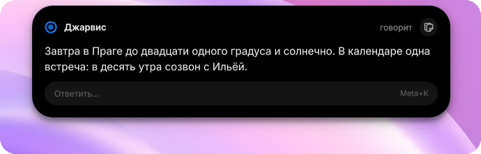<br><sub><b>Ответ</b> — голосом и текстом, можно сразу ответить или скопировать</sub></td>
<td width="50%" align="center">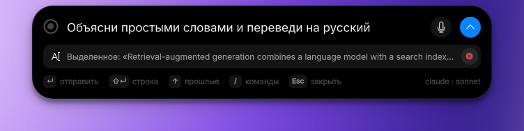<br><sub><b>Meta+K</b> — поле ввода, выделенный текст уже прикреплён</sub></td>
</tr>
<tr>
<td align="center">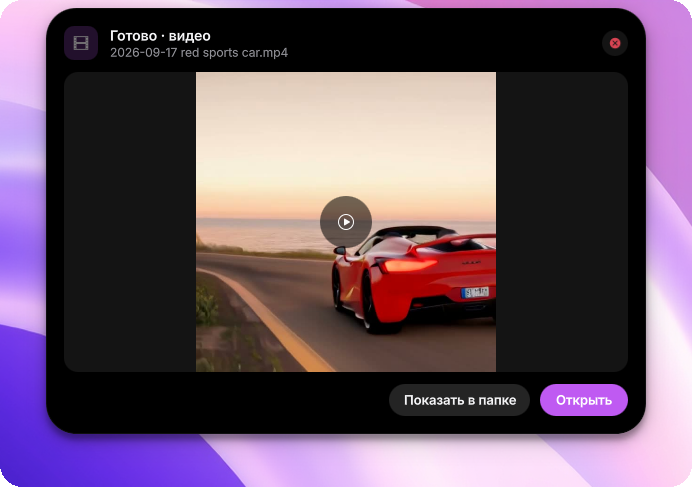<br><sub><b>Студия</b> — готовое видео с превью; долгие задачи идут в фоне</sub></td>
<td align="center">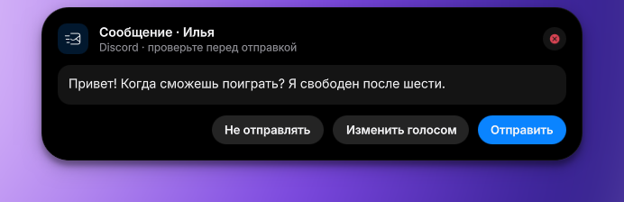<br><sub><b>Сообщение</b> — ничего не уходит без вашего «да»</sub></td>
</tr>
<tr>
<td align="center"><br>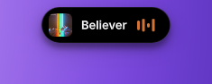<br><sub><b>Музыка</b> — альбомы и плейлисты, очередь, перемешивание и повтор; пока играет, сверху обложка и эквалайзер</sub></td>
<td align="center">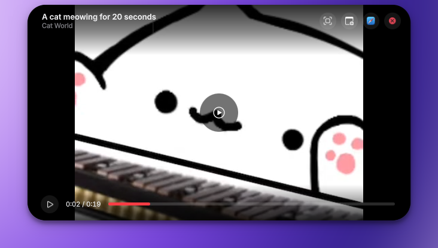<br><sub><b>Видео прямо в острове</b> — или в окне, или на YouTube: Джарвис спросит</sub></td>
</tr>
<tr>
<td align="center">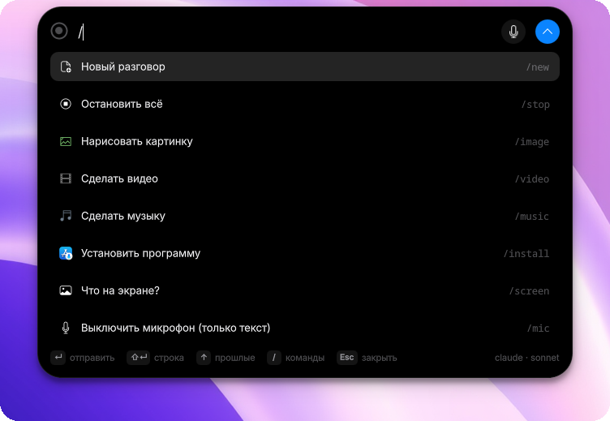<br><sub><b>/</b> — быстрые команды: новый разговор, картинка, видео, микрофон…</sub></td>
<td align="center">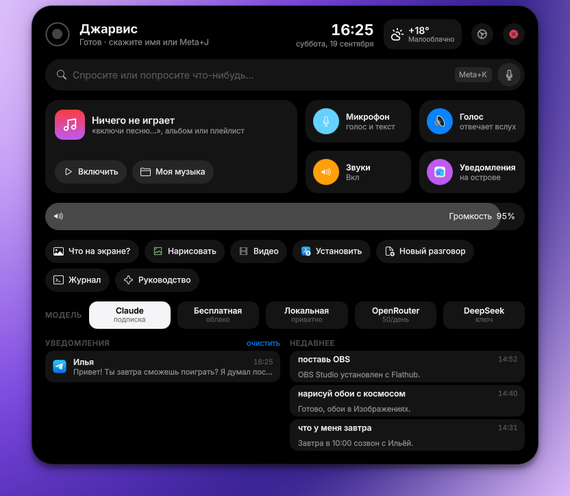<br><sub><b>Меню</b> — музыка, переключатели, три громкости (ассистент, музыка, система), модель, уведомления и недавнее</sub></td>
</tr>
<tr>
<td align="center">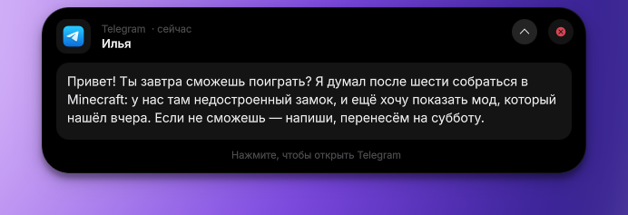<br><sub><b>Уведомления</b> — ⌄ раскрывает всё сообщение, ✕ убирает, клик открывает приложение — даже если оно свёрнуто в трей</sub></td>
<td align="center">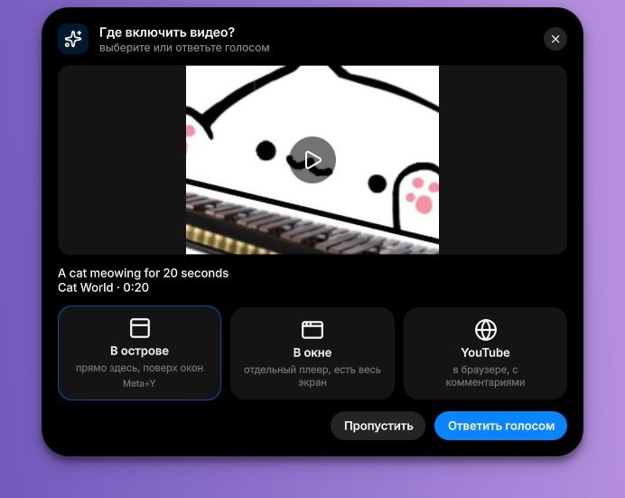<br><sub><b>Видео</b> — сам спросит, где показать</sub></td>
</tr>
<tr>
<td align="center"><br>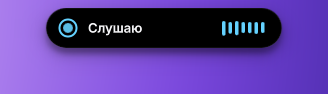<br><sub>Что делает прямо сейчас — человеческими словами</sub></td>
<td align="center">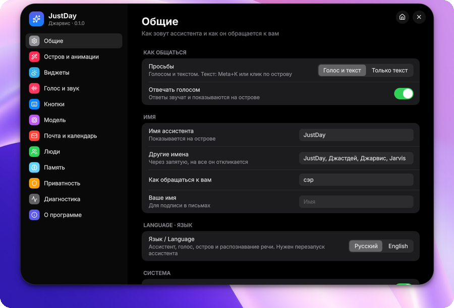<br><sub><b>Настройки</b> прямо в острове: 14 разделов</sub></td>
</tr>
<tr>
<td align="center"><br><sub><b>Обложка</b> — клик показывает её крупно; цвет острова берётся из обложки или из темы трека</sub></td>
<td align="center">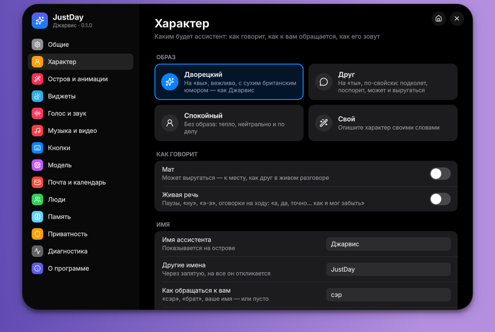<br><sub><b>Характер</b> — дворецкий, друг, спокойный или свой; мат и живая речь отдельно</sub></td>
</tr>
</table>

## Голосом или с клавиатуры

| Клавиши | Что делают |
|---|---|
| <kbd>Meta</kbd>+<kbd>J</kbd> (или кнопка мыши) | говорить: нажать — слушает до паузы, зажать — пока держите. В режиме «только текст» — поле ввода |
| <kbd>Meta</kbd>+<kbd>K</kbd> | написать просьбу; выделенный на экране текст прикрепляется |
| <kbd>Meta</kbd>+<kbd>Y</kbd> / <kbd>Meta</kbd>+<kbd>N</kbd> | «да» / «нет» на вопрос острова: разрешить действие, отправить сообщение |
| <kbd>Meta</kbd>+<kbd>Shift</kbd>+<kbd>J</kbd>, двойное нажатие или «стоп» | отменить всё |
| В поле ввода: <kbd>Enter</kbd> · <kbd>Shift</kbd>+<kbd>Enter</kbd> · <kbd>↑</kbd> · <kbd>/</kbd> · <kbd>Esc</kbd> | отправить · новая строка · прошлые просьбы · команды · закрыть |

**Без микрофона** (школа, офис, библиотека): *Настройки → Общие → Просьбы → «Только текст»*. Микрофон не открывается, распознавание речи даже не загружается, а ответы можно оставить только текстом (*«Отвечать голосом»*). Все сочетания меняются в *Настройки → Кнопки*.

## Музыка и видео

«Джарвис, включи песню Back in Black» — через 3–5 секунд она играет, без лишних слов. JustDay находит песню на YouTube (оригинал, а не кавер или часовую нарезку), скачивает звук в `~/Music/JustDay/YouTube` и играет в своём плеере. В следующий раз песня звучит с диска, даже без интернета. Можно альбом или плейлист целиком («включи альбом Meteora»), исполнителя («включи Linkin Park»), вперемешку или на повтор.

- Пока играет музыка, сверху висит **живая пилюля**: обложка, название и эквалайзер, а рядом — время, погода и то, что идёт в фоне. Клик открывает плеер с перемоткой, громкостью и очередью; клик по обложке — её крупно.
- **Цвет острова** — цвет обложки, а если обложка ничего не говорит (чёрная, серая), модель один раз подбирает цвет того, о чём трек: тема персонажа, палитра игры.
- «пауза», «дальше», «назад», «перемешай», «на повтор», «выключи повтор», «выключи музыку» работают мгновенно, без ИИ. В плеере те же кнопки и очередь: клик по песне включает её. Пока Джарвис слушает или говорит, музыка становится тише.
- Плеер — отдельная служба, поэтому музыка не прерывается, даже если перезапустить ассистента.

«Включи видео про чёрные дыры» — Джарвис найдёт ролик и **спросит, где его показать**:

- **В острове** — ролик загружается (до 720p) и играет прямо сверху экрана. Поверх него идут подписи ассистента, двойной клик открывает видео на весь экран.
- **В окне** — отдельный плеер mpv, стартует сразу.
- **YouTube** — страница в браузере, с комментариями.

Чтобы не спрашивал каждый раз, выберите вариант в *Настройки → Музыка и видео*.

## Студия

Скажите или напишите: «нарисуй логотип с прозрачным фоном», «оживи это фото», «сделай лоу-фай бит на 30 секунд», «преврати фото кресла в 3D-модель», «вырежи паузы из видео и сделай вертикальное для шортсов».

| Что | Как долго на RTX 3060 |
|---|---|
| Картинка, картинка без фона, увеличение ×4 | 10–40 с |
| Правка фото по словам | 1–2 мин |
| Музыка и песни (с вокалом) | ~15 с на 10 с трека |
| 3D-модель из текста или фото → GLB + STL | ~3 мин, в фоне |
| Видео из текста или фото | ~8 мин на 3 с, в фоне — JustDay сам скажет, когда готово |
| Озвучка вашим голосом ассистента, субтитры из речи | секунды |
| Монтаж: обрезать, склеить, музыка под видео, вшить субтитры, вертикальное 9:16, убрать паузы, ускорить, GIF, слайдшоу | секунды, ffmpeg |

Генерация идёт через локальный [ComfyUI](https://github.com/comfyanonymous/ComfyUI) с моделями FLUX.1-schnell, Qwen-Image-Edit, Wan 2.2, ACE-Step и Hunyuan3D. JustDay находит его сам (`~/ai-local/ComfyUI`, `~/ComfyUI` или `[studio] comfy_dir`), запускает только на `127.0.0.1` и в отдельной службе с лимитом памяти. Проверка: `justday studio status`. Монтаж, субтитры и озвучка работают и без видеокарты.

## Модели

| Провайдер | Цена | Что нужно |
|---|---|---|
| **Claude** (по умолчанию) | подписка Claude | вход в Claude Code — мастер поможет |
| **Бесплатная** — облако Ollama | бесплатно с лимитами | бесплатный аккаунт Ollama |
| **OpenRouter** `openrouter/free` | бесплатно, ~50 запросов в день | ключ OpenRouter |
| **DeepSeek** | дёшево | ключ DeepSeek |
| **Локальная** Ollama | бесплатно, ничего не уходит в сеть | видеокарта от 10 ГБ |
| Свой адрес | — | любой Anthropic-совместимый API (LiteLLM, vLLM…) |

Память, навыки и записная книжка общие для всех моделей. Смена: остров → меню → «Модель» или `justday model use <провайдер> <модель>`.

## Приватность

| Остаётся на компьютере | Уходит в облако |
|---|---|
| звук микрофона и распознавание речи, голос ассистента (кроме ElevenLabs, если выбран) | текст ваших просьб и ответы — выбранной модели |
| письма, календарь, мгновенные команды | выделенный текст — только если он прикреплён к просьбе (видно в поле) |
| картинки, видео, музыка и 3D из студии | название города для погоды (Open-Meteo) |
| пароли и ключи — в системной связке ключей, не в памяти ассистента | названия треков — по одному разу, когда остров подбирает цвет по музыке (можно выключить) |

Телеметрия Claude Code выключена. Опасные действия (удаление, `sudo`, форс-пуш…) ждут вашего подтверждения — в том числе запущенные фоновой задачей, а обычный запуск программ — нет. Подробнее — в [руководстве](docs/MANUAL.md); полный список сервисов и как удалить свои данные — [политика конфиденциальности](docs/КОНФИДЕНЦИАЛЬНОСТЬ.md), условия — [соглашение](docs/СОГЛАШЕНИЕ.md).

## Команды

```bash
justday ask "открой дискорд"          # просьба текстом из терминала
justday compose                       # открыть поле ввода на острове
justday play "AC/DC Back in Black"   # песня с YouTube в свой плеер (count=5 — несколько)
justday video "черные дыры" where=island  # видео: island | window | browser (без where — спросит)
justday play "Linkin Park Meteora" playlist=1 shuffle=1   # альбом вперемешку
justday player repeat one             # pause | next | prev | repeat off|all|one | shuffle on|off | seek 60 | volume 50 | color жёлтый
justday job start "Обновление системы" -- jii update --json   # долгое — в фон
justday persona friend swearing=on live=on                   # характер: jarvis | friend | calm | custom
justday studio image "a red fox, watercolor" size=wide
justday studio vertical ~/Videos/clip.mp4
justday plan add "забрать посылку"    # планы в Obsidian: list | add | done 1 | open
justday scene run работа              # сценарии: list | run | add | forget
justday diary                         # страница дня в хранилище
justday tokens                        # во что обходится разговор, по дням
justday wake                          # кто будит ассистента и сколько раз впустую
justday setup                         # мастер настройки заново
justday doctor                        # проверка всего
justday update                        # обновиться (остров подскажет, когда есть новое)
justday logs -f                       # что он слышит и делает
```

<details>
<summary><b>Частые вопросы</b></summary>

**Работает без видеокарты NVIDIA?** Да. Мастер выберет распознавание речи на процессоре (или режим «только текст»), простой голос Silero и облачную модель. Недоступны только живой голос, локальные модели и генерация в студии.

**Можно вообще без голоса?** Да: *Настройки → Общие → «Только текст»* и выключить *«Отвечать голосом»*. <kbd>Meta</kbd>+<kbd>K</kbd> открывает поле ввода.

**Он сам что-нибудь отправит или удалит?** Сообщения и письма — только после вашего «да». Удаление файлов, `sudo`, удаление программ и другие опасные действия — тоже с подтверждением.

**Другие окружения (GNOME, X11, Plasma 5)?** Работает, только вместо острова — запасная полоска сверху экрана (на Tk): состояние, ответы, меню правой кнопкой с «Написать…», «Остановить» и кнопками плеера. Окнами управляют `wmctrl` и `xdotool`, снимок экрана берётся любым найденным инструментом, выделенный текст читается через `xclip`, горячие клавиши в GNOME ставит `scripts/setup-hotkey-gnome.sh`. Установщик определяет всё это сам — и не один раз: если на компьютере есть и Wayland, и X11, нужное выбирается при каждом входе, переустанавливать при смене сеанса нечего. Только для KDE Plasma 6 на Wayland остаются сам остров (плеер, видео в кадре, карточки писем) и точные клики по разметке чужих окон.

**Нет прав администратора (`sudo`)?** Установка идёт до конца: всё, кроме системных пакетов, живёт в домашней папке. Установщик поставит `uv`, Claude Code, окружение Python и модели, а `yt-dlp` для музыки возьмёт себе же через `uv tool`. В конце он перечислит, чего не хватает и что именно от этого не работает, с готовой командой для администратора. Можно и сразу без вопросов: `JUSTDAY_NO_SUDO=1 ./install.sh`.

**Где файлы из студии?** В `~/Pictures/JustDay`, `~/Videos/JustDay`, `~/Music/JustDay` и `~/Documents/JustDay/3D`; на острове есть кнопки «Открыть» и «Показать в папке».

</details>

📖 **[Все команды](docs/КОМАНДЫ.md)** — список подкоманд `justday` (80 штук, сверяется тестом).

📖 **[Полное руководство](docs/MANUAL.md)** — устройство, модели, голос, память, почта, игры, студия, безопасность, решение проблем.

## Участие

Баги и идеи — в [Issues](https://github.com/0nigiris/JustDay/issues). Код (кроме имён переменных и API), комментарии и история коммитов — на русском; интерфейс — на русском и английском (`island/i18n`, `src/justday/i18n.py`). Скриншоты для README снимаются в изолированной сессии KWin с настройками по умолчанию, по-русски и по-английски: `SHOTS_LANG=ru|en tests/ui/readme_shots.sh`.

---

<a id="english"></a>

**English:** the whole page, with English screenshots, is in **[README.en.md](README.en.md)**.

## Лицензия · License

JustDay © 2026 [0nigiris](https://github.com/0nigiris) — **GNU GPL v3 или новее** ([LICENSE](LICENSE)): код можно менять и распространять, сохраняя авторство и открытый исходный код производных версий под GPL.

Сторонние части: иконки [Lucide](https://lucide.dev) (ISC); встроенные голоса созданы моделью Qwen3-TTS (Apache 2.0); идеи интерфейса вдохновлены Dynamic Island, компаньон-окном ChatGPT и Quick AI в Raycast.
